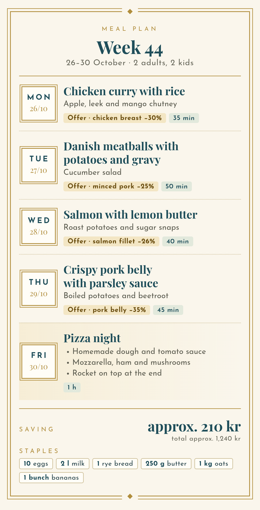
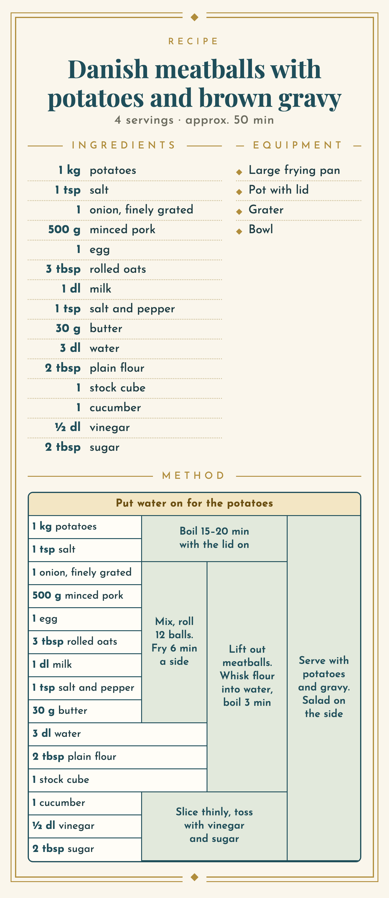

# Sylvester Chatwell 🎩

Sylvester Chatwell is a household butler for Denmark that lives inside
**xAI's Grok Bot**. Point your Bot at this repository and it installs its own
tools on its cloud computer, interviews you about what your household eats,
plans next week's dinners around the current offers on
[nemlig.com](https://www.nemlig.com), fills your nemlig basket with exact
quantities, and sends meal plans and recipes as phone-sized cards. It runs on
your own Grok account with your own nemlig login — there is no server, no
middleman and no extra subscription.

## Set it up in 5 steps (+ bonus)

1. **Buy a Grok Premium subscription** (includes Grok Bot) — https://x.ai/pricing
2. **Point your Bot at the repo.** Start a new Bot and paste one sentence:
   > Set yourself up from https://github.com/OneManMobile/sylvester-chatwell, follow BOT.md
3. **Give it your nemlig.com credentials.** When the Bot asks, take over the
   Bot's computer and type the password in the terminal yourself
   (`bin/nemlig account login you@example.com`). Never paste passwords in chat.
4. **Ask it to learn your meal preferences** — diet and allergies, weekly
   staples, pizza night?
5. **Ask it to make a meal plan for next week and fill the nemlig basket while
   doing it.** It never places the order — you tap **Bestil** (Order) on
   nemlig.com yourself.

**BONUS:** ask it for a recipe card for one of the days.

## What you get

<p align="center">
  
  
</p>

Danish versions of the same cards, plus a shareable five-step setup card in
both languages, are in [`examples/da/`](examples/da) and
[`examples/en/`](examples/en).

**It can**
- Plan the week's dinners around nemlig.com's current offers, your diet,
  allergies, fixed nights and weekly staples — and avoid repeating itself.
- Fill the nemlig.com basket with exact quantities (whole packs, offers first,
  products you bought before), then show the item list and total as proof.
- Send meal plans, recipes (ingredients, tools and a Cooking-for-Engineers
  step grid) and an optional week overview as images in the chat.
- Remember preferences and feedback ("not so spicy", "make that again") in
  files on your Bot's computer.
- Run on a schedule if you want — e.g. a meal plan every Saturday at 09:00
  (Grok Bot routines; only created when you say yes).
- Reserve a delivery slot when you ask for it.

**It can't / won't**
- Place or pay an order. You always tap **Bestil** on nemlig.com yourself.
- Change your basket without being asked.
- Shop anywhere other than nemlig.com.

## Safety and privacy

- **Never orders.** The tooling has no command to place an order; the Bot is
  also instructed never to try.
- **Your credentials stay with you and your own Bot computer — never in the
  chat.** Three ways to log in, best first:
  1. *Grok Bot secrets* `NEMLIG_EMAIL` / `NEMLIG_PASSWORD`, if your Bot lets
     you add secrets or makes a secure secret request: the Bot uses them by
     name without seeing the password and can log in again by itself. Secrets
     are fully documented for Team Bots; for personal Bots they're only
     offered for some connections, so this may not be available to you.
  2. *You log in yourself*: take over the Bot's computer and type
     `bin/nemlig account login you@example.com` in its terminal. The CLI keeps
     only a session cookie (in `/workspace/.sylvester/nemlig-cli`, readable
     only by your account); when nemlig.com ends the session after a while,
     you log in again the same way.
  3. *Credentials file* (optional): lets the Bot log in again by itself
     without secrets — convenient, but the password then sits in plain text
     on that computer.
  Details in [BOT.md](BOT.md#4-connect-nemligcom-the-user-does-this-not-you).
- **The nemlig.com integration is unofficial.** It uses the community
  [Nemlig.com-CLI](https://github.com/tobiasdosdal/Nemlig.com-CLI), which talks
  to the same web API as the website. nemlig.com can change that at any time,
  and then it can break until the CLI is updated. Not affiliated with
  nemlig.com or xAI.
- Household data (preferences, meal log, cards) lives in
  `/workspace/sylvester-household` on your Bot's computer and nowhere else.

## Costs

Grok Premium, which includes Grok Bot: **$30/month** (see
https://x.ai/pricing). Nothing else — this project is free, and the groceries
are whatever you decide to order.

## Languages

Sylvester writes in your language: Danish by default, English when you write
in English or ask for it. The cards come in Danish (`"lang": "da"`) and English
(`"lang": "en"`) — headings, weekday and month names, hyphenation. Product
names stay as nemlig.com spells them.

## Repository layout

```
README.md            this file
BOT.md               the instructions the Grok Bot follows to set itself up
install.sh           idempotent installer (everything goes into .venv/ and .deps/)
bin/doctor           quick health check; tells you to run ./install.sh if needed
bin/recipe-card      renders card specs (JSON) to PNG with headless Chrome
bin/nemlig           the nemlig.com CLI (Nemlig.com-CLI + patches)
bin/nemlig-keepalive checks / renews the nemlig.com login (exit 0/1/3/4)
skills/              Grok Bot skills: onboarding, nemlig-household, recipe-cards, family-week
templates/           household files copied to /workspace/sylvester-household
nemlig-cli-patches/  patches applied to Nemlig.com-CLI (offers list, slot changes)
fonts/               OFL fonts used by the cards
examples/en/         English example cards: meal plan, recipe, setup steps (spec + PNG)
examples/da/         the same examples in Danish
```

## For developers: install and test by hand

Linux (x64/arm64) or macOS, no root needed:

```sh
git clone https://github.com/OneManMobile/sylvester-chatwell
cd sylvester-chatwell
./install.sh                        # uv + Python venv, Node 20+, nemlig CLI, headless Chromium (Linux)
bin/doctor                          # checks everything, incl. the nemlig login
bin/recipe-card examples/en/recipe.json   # → examples/en/recipe.png
bin/nemlig --help
bin/nemlig account login you@example.com   # optional; type the password yourself
```

`install.sh` uses apt only when you are root or have passwordless sudo and
something is missing; otherwise it downloads everything in user space
(including Chromium's libraries via `apt-get download` on Debian/Ubuntu). On
macOS it uses your installed Google Chrome. Paths can be overridden with
`SYLVESTER_STATE` (login dir parent), `SYLVESTER_HOUSEHOLD` and
`RECIPE_CARD_CHROME`.

## Credits

- [Nemlig.com-CLI](https://github.com/tobiasdosdal/Nemlig.com-CLI) by
  tobiasdosdal (MIT) — the nemlig.com integration; this repo adds two small
  patches.
- Fonts in `fonts/` are licensed under the SIL Open Font License (see the
  `OFL.txt` next to each font).
- Card layout inspired by [Cooking For Engineers](https://www.cookingforengineers.com).

## License

MIT — see [LICENSE](LICENSE).
